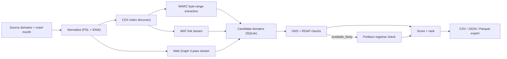

# Expired Domain Finder

Find expired domains that authoritative publishers still link to, checked for availability and ranked with evidence, from free Common Crawl data instead of paid backlink tools.

> Built by **Satya Janghu**, a digital marketing expert specializing in SEO, AI search, and organic growth marketing. [getsatya.com](https://getsatya.com) · [satya@getsatya.com](mailto:satya@getsatya.com)


## Why it exists

An expired domain that respected publishers still link to is one of the most valuable assets in link building, and one of the slowest to find. The usual route is paying for third-party backlink databases, exporting outbound links by hand, and checking WHOIS one domain at a time, which can take days per prospect list. Common Crawl already holds the link graph of the public web for free. Expired Domain Finder (`edf`) turns that raw data into a ranked, evidence-backed list of domains you can actually register, on your own machine, with runs that survive crashes and can last for days.

## What it does

- **Pick a publisher, get a shortlist.** Give it 1 to 10 source domains and a crawl ID or month (`--crawl 2024-03` resolves to the closest older-or-exact crawl), and one `edf find` command returns ranked candidates.
- **Reads Common Crawl three ways:** exact WARC byte-range fetches, the WAT link-metadata stream, and the domain-level Web Graph, alone or combined.
- **Checks availability in layers.** DNS, then RDAP, then the Porkbun registrar API, sorted into 14 statuses (from `available_registrar_confirmed` to `pending_delete`, `premium` and `restricted_tld`) with 4 confidence levels. Missing DNS alone never counts as "available".
- **Scores every candidate** on availability, confidence and evidence strength (WARC, WAT and graph observations), with no `.com` bias.
- **Exports what an SEO team needs:** CSV, JSON or Parquet with evidence counts, status, confidence, TLD policy, registrar price summary and a `manual_verification_required` flag on every row.
- **Runs unattended for days.** Registrar rate limits are turned into scheduled retry windows, and a killed process resumes where it stopped.
- **Watch it live** from another terminal with pause, resume and stop controls, or use the optional Linux desktop console for single-domain runs.
- **Keeps credentials private.** Registrar keys come only from environment variables and are redacted from config output, stored run state and errors.

## How it works



1. **Normalize.** Source domains are reduced to their registrable domain using the Public Suffix List and IDNA, so `https://www.example.co.uk/page` and `example.co.uk` are the same source.
2. **Discover.** The Common Crawl CDX index is paginated page by page with per-page state. If the API is flaky, discovery falls back to a local CDX cache and then to the raw `cluster.idx` index.
3. **Extract.** WARC records are fetched by exact byte range, WAT sidecars are streamed line by line, and the Web Graph is streamed in three passes (vertices, edges, vertices) so the graph never sits in memory or in SQLite. Every outbound domain becomes a candidate with its evidence written to Parquet/ZSTD files.
4. **Verify.** Each candidate gets DNS (NS, A/AAAA, MX, SOA) and RDAP checks. Only domains that look available move on to Porkbun for registrar confirmation and pricing.
5. **Rank and export.** Candidates are scored and written to `runs/<run-id>/artifacts/exports/results.csv` (or JSON/Parquet), and a results table is printed.

All operational state lives in a per-run `run_state.sqlite` plus a global `domain_cache.sqlite`, so a domain checked last week is not checked again until its cache entry expires.

## Engineering highlights

- **Crash recovery by design.** Work is split into leased tasks (5-minute leases for WARC, WAT and availability, 10 minutes for graph). Expired leases and stuck CDX pages go back to the queue when a run is reopened, and each recovery is logged as an event. Tasks get up to 8 attempts.
- **Retries that never double-count.** Artifacts are written to `.tmp`, hashed with SHA-256, atomically renamed, then committed with stable batch keys in the same transaction as candidate updates. A retried batch is recognized and skipped.
- **Stage-level worker pools.** Default concurrency is CDX 4, WARC 48, WAT 8, Graph 4, DNS 300, RDAP 20 and Registrar 10, all configurable.
- **Polite, resilient HTTP.** The Common Crawl client retries up to 7 times with jittered exponential backoff (250 ms base, 5 s cap) and honors `Retry-After`. Registrar rate limits are parsed from `ttlRemaining`, `Retry-After` or `X-RateLimit-Reset` and stored as the task's next attempt time, so multi-day runs wait out quotas instead of burning retries.
- **Hard safety caps.** Defaults of 8 MiB per WARC record, 16 MiB decoded body, 2 GiB per WAT or graph object, and a 10 MiB WAT line limit. WARC range responses must match the requested length exactly, and a CDX result over budget is rejected rather than silently truncated.
- **Low-level DNS work.** Besides standard lookups, the checker sends a hand-built DNS wire-format SOA query and parses the response with a compression-loop guard.
- **Tuned SQLite.** WAL mode, `synchronous=NORMAL`, foreign keys on, a 30-second busy timeout, one connection per database, embedded schemas and a versioned migration runner.
- **Honest progress and ETA.** Progress refreshes every 10 seconds, using an exponential moving average (alpha 0.35) of throughput per stage with a confidence label. When a run ends, its events are sealed into `logs/events.jsonl.zst`.
- **Validated against live data.** A bounded WAT run cleanly ingested 31,771 link observations and 20,341 candidate domains in idempotent batches, and a force-kill drill resumed with no duplicated records. See the validation table in [docs/smoke-run.md](docs/smoke-run.md).
- **Test suite.** 167 test functions and 4 benchmarks across 16 test files, many of them table-driven. Integration tests mock Common Crawl, RDAP and Porkbun with `httptest` servers, and the documented quality gate includes `go test -race ./...`.

## Tech stack

| Layer | Technology |
|---|---|
| Language | Go 1.26, standard `flag` CLI, about 9,800 lines of source across 13 internal packages |
| Operational state | SQLite via `modernc.org/sqlite` (pure Go, so the CLI builds without cgo) |
| Evidence artifacts | Parquet with ZSTD (`parquet-go`), zstd streams (`klauspost/compress`) |
| Domain handling | `golang.org/x/net` publicsuffix, idna and html |
| Desktop console (optional) | Fyne v2.7, Linux with cgo |
| Data sources | Common Crawl CDX, WARC, WAT and Web Graph; IANA RDAP bootstrap; Porkbun API v3 |

## Project evolution

**Started as** a full product and engineering spec written before any code: a product brief, PRD, personas, epics and acceptance criteria, four architecture decision records (Go + SQLite, SQLite for operational state, Parquet/ZSTD for artifacts, dependency choices) and eight engineering documents covering the pipelines, storage schema, crash recovery, performance, security and testing.

**Became** a production-grade Go CLI with three Common Crawl ingestion modes, a 14-status availability classifier, crash-recoverable per-run state, a shared domain cache, Parquet/ZSTD evidence files and a one-command `edf find` workflow, plus a terminal watch view and an optional desktop operations console.

## Roadmap

- A full-screen terminal UI built on the same SQLite monitoring model.
- A domain watchlist with scheduled rechecks (the database table is already in the schema).
- Multi-source and Web Graph controls in the desktop console.
- Byte-offset checkpoints inside large WAT files for finer-grained resume.
- Panic diagnostics stored in the run database alongside the event log.
- Visual snapshot tests for the desktop console.

## Running it locally

**Prerequisites:** Go 1.26 or newer. The desktop console also needs Linux with cgo and Fyne's system libraries.

```bash
go build -buildvcs=false -o bin/edf ./cmd/edf

# Optional: registrar confirmation (see .env.example). Without these, results stop at DNS/RDAP confidence.
export PORKBUN_API_KEY=your-porkbun-api-key
export PORKBUN_SECRET_KEY=your-porkbun-secret-key

./bin/edf --data-dir ./edf-data find \
  --source example.org --crawl CC-MAIN-2024-10 \
  --mode warc --mode wat \
  --cdx-limit 0 --warc-task-limit 0 --wat-task-limit 0 \
  --availability-limit 0 --max-runtime 0
```

`find` creates the config and databases on first use. From another terminal, `./bin/edf --data-dir ./edf-data run watch <run-id>` shows live progress (`p` pause/resume, `s` stop, `q` quit). After an interruption, `run status` lists runs and `run resume <run-id>` picks up where it stopped. Run the tests with `go test ./...`.

## Documentation

- Operations: [CLI and watch view](docs/cli-tui.md), [operator runbook and validation results](docs/smoke-run.md), [product decisions](docs/product-decisions.md), [contributing](docs/CONTRIBUTING.md)
- Product: [brief](product/00_product_brief.md), [PRD](product/01_prd.md), [personas and use cases](product/02_personas_and_use_cases.md), [epics and user stories](product/03_epics_user_stories.md), [acceptance criteria](product/04_acceptance_criteria.md)
- Decisions: [ADR 0001: Go CLI with SQLite](adr/0001_go_cli_tui_sqlite.md), [ADR 0002: SQLite for operational state](adr/0002_sqlite_for_operational_state.md), [ADR 0003: Parquet/ZSTD artifacts](adr/0003_parquet_zstd_for_artifacts.md), [ADR 0004: dependency choices](adr/0004_go_dependency_choices.md)
- Design: [UI/UX spec](design/05_ui_ux_spec.md), [TUI reference](design/06_tui_reference.md), [GUI design system](design/07_gui_design_system.md)
- Engineering: [architecture](engineering/07_architecture.md), [Common Crawl pipelines](engineering/08_common_crawl_pipelines.md), [availability pipeline](engineering/09_domain_availability_pipeline.md), [storage schema](engineering/10_storage_schema.md), [progress, ETA and crash recovery](engineering/11_progress_eta_crash_recovery.md), [performance and parallelism](engineering/12_performance_parallelism.md), [security and privacy](engineering/13_security_privacy_compliance.md), [testing strategy](engineering/14_testing_strategy.md), [pipeline hardening](engineering/15_pipeline_hardening.md)
- Schemas: [config schema](schemas/app_config.schema.json), [run state](schemas/run_state_schema.sql), [domain cache](schemas/domain_cache_schema.sql), [artifacts](schemas/artifact_schema.sql)

## About the author

> Built by **Satya Janghu**, a digital marketing expert specializing in SEO, AI search, and organic growth marketing. [getsatya.com](https://getsatya.com) · [satya@getsatya.com](mailto:satya@getsatya.com)

Satya turns the slow, manual research behind SEO and link building into repeatable pipelines that run on open data.

## License

All rights reserved. See [LICENSE](LICENSE).
